Этот аддон позволяет упростить торговлю, делая ее более простой.
Аддон сканирует аукцион и добавляет цену к выбранному предмету в меню подсказки.

Как это работает?

При выборе предмета, который мы собираемся добавить на аукцион, Auctionator отображает общие данные по всем аукционам на выбранный нами предмет, сортируя по ценам за одну штуку. Аддон предлагает цену выкупа, основанную на самой дешевой цене за штуку вашего предмета.

**Скриншоты:**

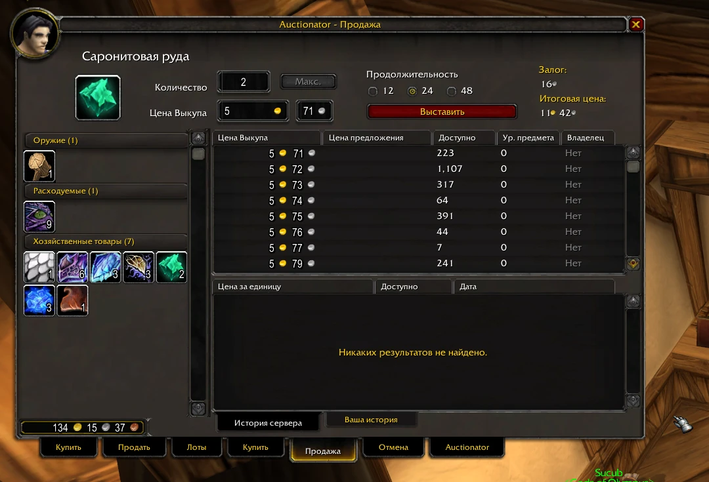
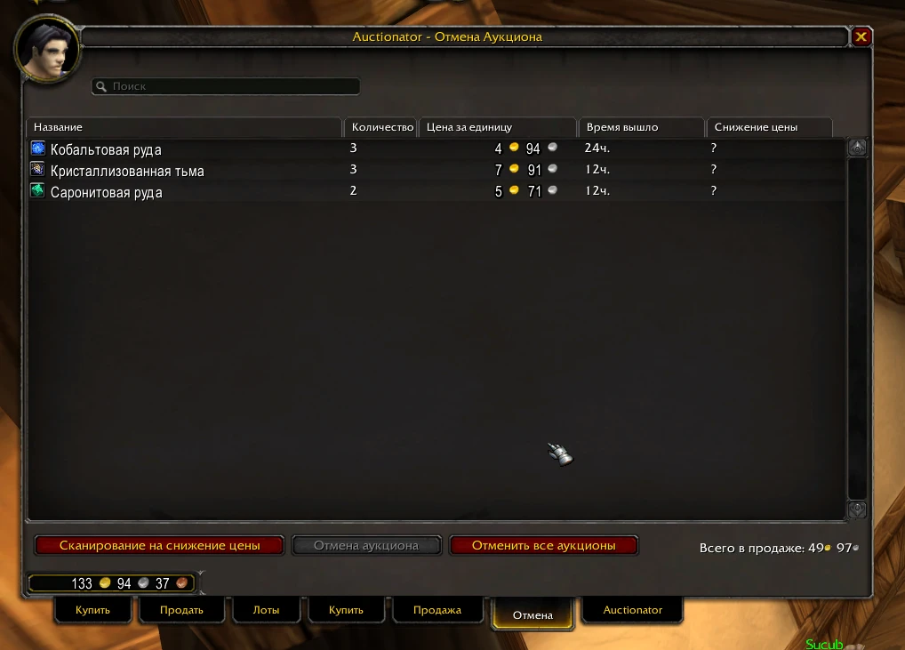
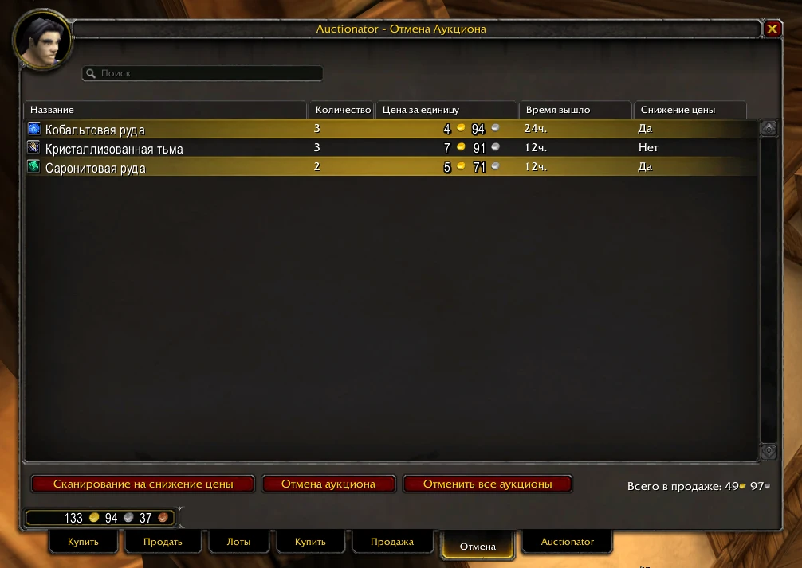
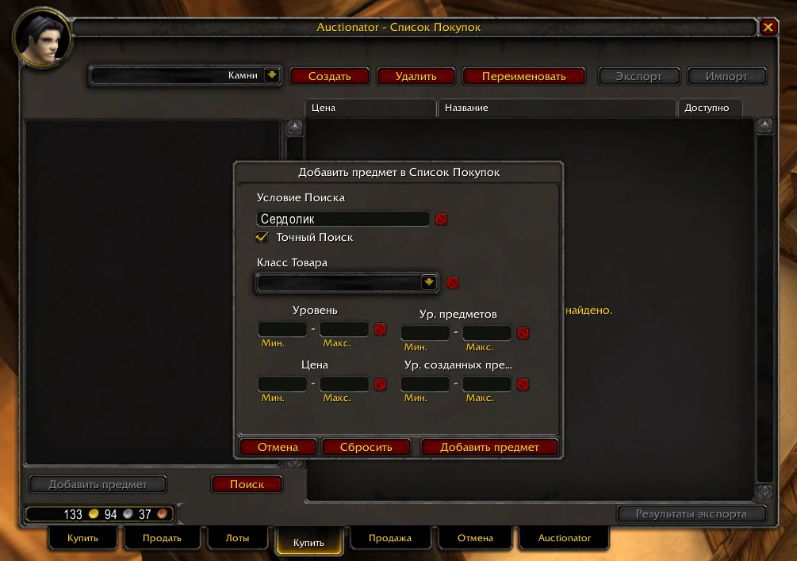
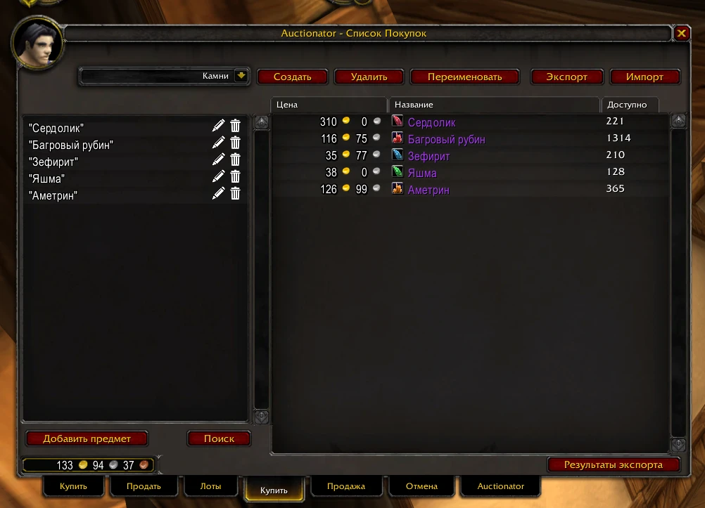
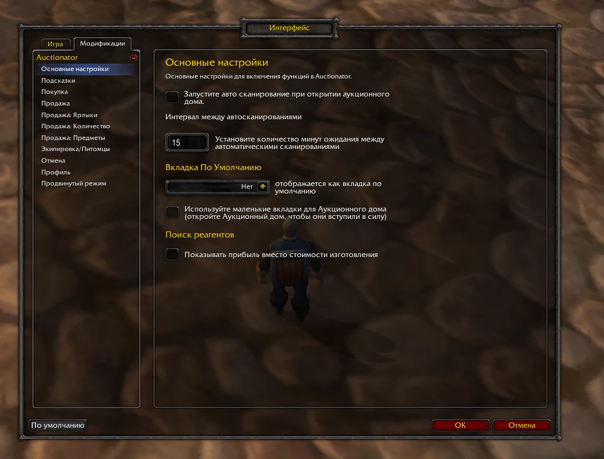
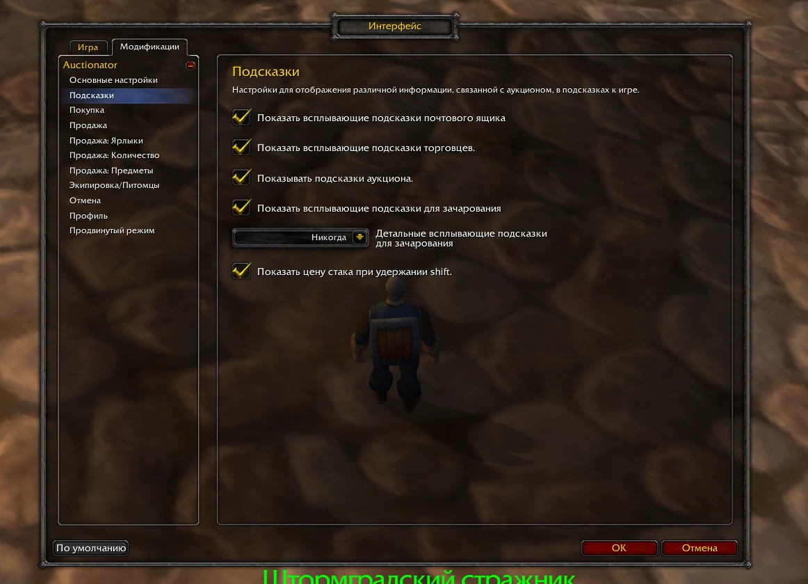
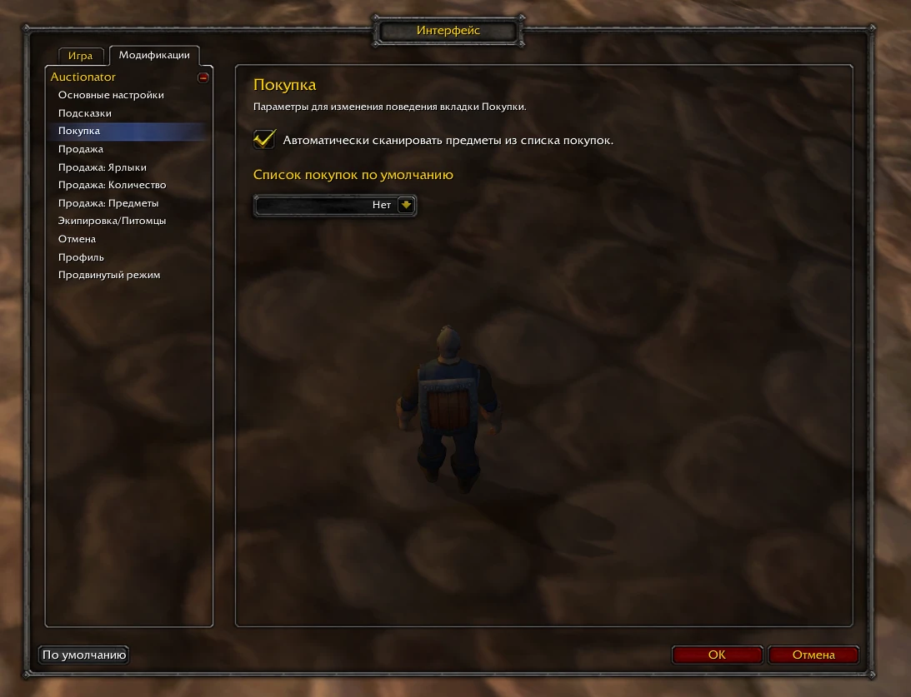
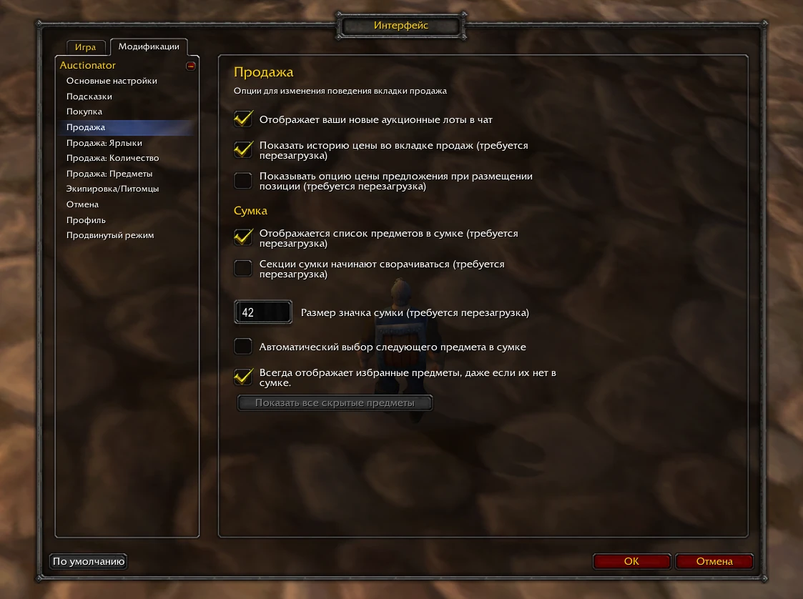
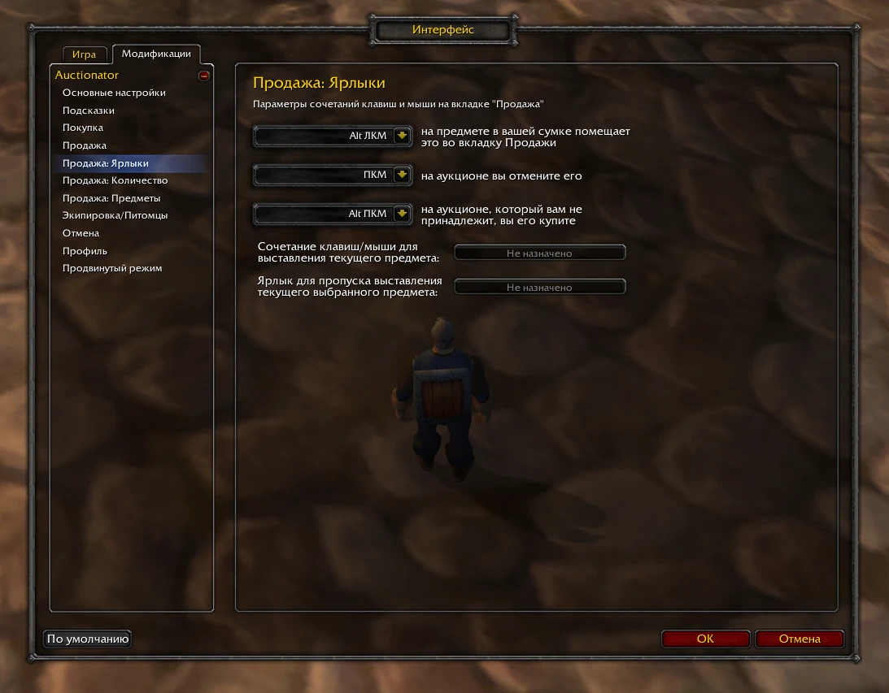
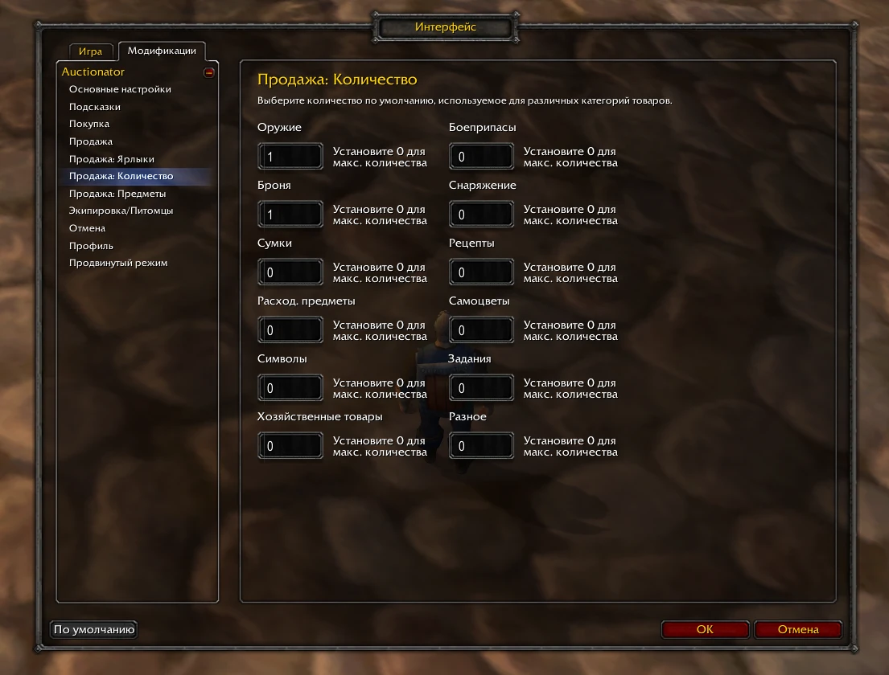
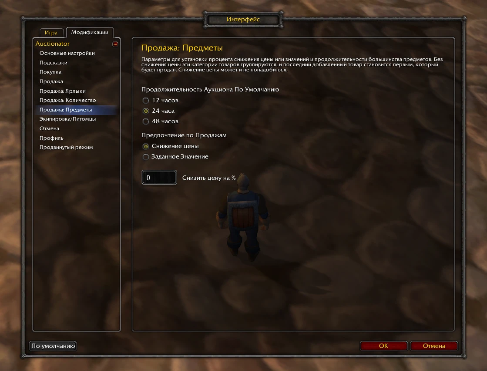
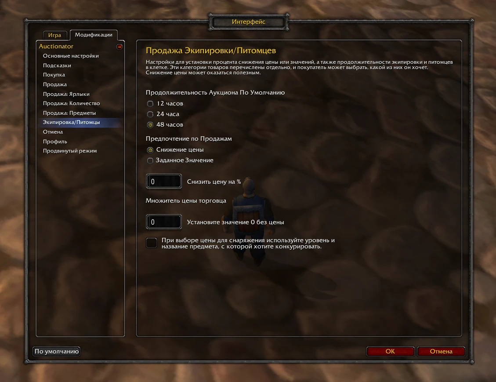
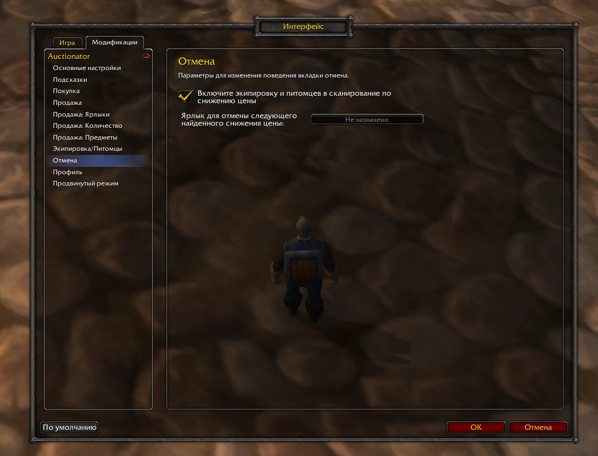
